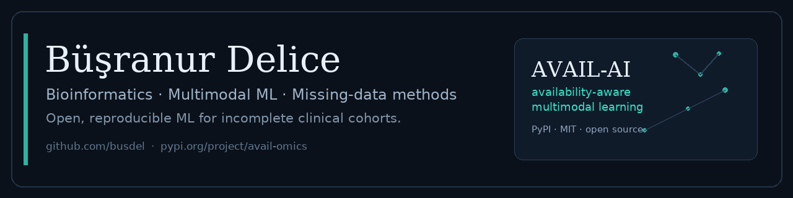

  

### Computational biology · microbiome · multimodal machine learning

I study how microbial communities and brain networks relate to health and disease, and I build reproducible machine-learning methods for clinical cohorts. My work spans metagenomics, neuroimaging, longitudinal microbiome data, and availability-aware multimodal learning.

I am currently preparing the two companion **AVAIL-AI** manuscripts and maintaining the open-source package and web platform.

---

## Featured: AVAIL-AI

**Availability-aware multimodal learning.** Per-modality specialists, explicit availability flags, and a leak-free benchmark for cohorts in which no subject has every measurement. Eleven meta-learners, group-aware readouts, and an open Python package.

- **Code:** [busdel/avail-cloud-runner](https://github.com/busdel/avail-cloud-runner)
- **Package:** [avail-omics on PyPI](https://pypi.org/project/avail-omics/) (`pip install avail-omics`)
- **Demo / docs:** [busdel.github.io/avail-cloud-runner](https://busdel.github.io/avail-cloud-runner/)
- **Deployment:** local runner, self-hosted interface, or user-owned compute

## Publications

**Peer-reviewed**

1. Boyaci I, **Delice B**, Koc F, Yildirim S. *Ramadan fasting induces temporal gut microbiome remodeling without metabolic improvement in adults with prediabetes.* **Microbiology Spectrum** 2026. [doi:10.1128/spectrum.00742-26](https://doi.org/10.1128/spectrum.00742-26)
2. Altın H, **Delice B**, Yıldırım B, Demircan T, Yıldırım S. *Temporal microbiome changes in axolotl limb regeneration: stage-specific restructuring of bacterial and fungal communities.* **Wound Repair and Regeneration** 2024. [doi:10.1111/wrr.13207](https://doi.org/10.1111/wrr.13207)

**Preprints**

3. **Delice B**, Nalbantoğlu ÖU, Yıldırım S. *Integrative analysis of neuroimaging and microbiome data predicts cognitive decline in Parkinson's disease.* **bioRxiv** 2025. [doi:10.1101/2025.03.28.645180](https://doi.org/10.1101/2025.03.28.645180)

**In preparation**

- *AVAIL-AI: availability-aware integration of brain imaging and gut–oral microbiome data under missing modalities* (companion application paper)
- *Dr. AVAIL: an availability-aware multimodal integration framework and software ecosystem* (companion methods/software paper)

## Research focus

- Microbiome–neuroimaging integration in Parkinson's disease and cognitive decline
- Availability-aware / missing-modality learning for clinical multimodal data
- Longitudinal and cross-sectional metagenomics (16S, ITS, shotgun, KEGG)
- Reproducible ML: leak-free evaluation, permutation controls, calibration, conformal prediction

## Selected projects

| Project | What it is |
|---|---|
| **AVAIL-AI** | Availability-aware multimodal framework; Python package, CLI, web interface; two companion manuscripts in preparation |
| **Parkinson's microbiome + rs-fMRI** | Multimodal workflow linking gut/oral microbiome and network connectivity to cognitive staging |
| **Axolotl limb regeneration** | 16S + ITS network analysis of stage-specific bacterial and fungal shifts; published in *Wound Repair and Regeneration* |
| **Prediabetes / Ramadan microbiome** | Longitudinal gut microbiome remodeling during Ramadan fasting; published in *Microbiology Spectrum* |
| **Education-driven research initiative** | Training medical students in clinically meaningful machine learning; [repository](https://github.com/busdel/education-driven-research-initiative) |
| **Microbiome correlation networks** | Compact R workflow for microbial co-occurrence/correlation networks; [repository](https://github.com/busdel/microbiome-corr-networks-mini) |
| **HeartHelper** | Streamlit + FAISS + Gemini digital-health assistant; Google AI Academy project |

## Toolbox

## Connect

I am open to research collaborations in microbiome–brain-axis work, clinical multimodal ML, and reproducible research software.

- Email: **delicebusranur@gmail.com**
- LinkedIn: [busranur-d-84a7371a4](https://www.linkedin.com/in/busranur-d-84a7371a4/)
- ResearchGate: [Büşranur Delice](https://www.researchgate.net/profile/Buesranur-Delice)
- GitHub Pages: [AVAIL-AI project](https://busdel.github.io/avail-cloud-runner/)

> “Make the evaluation as serious as the model.”
